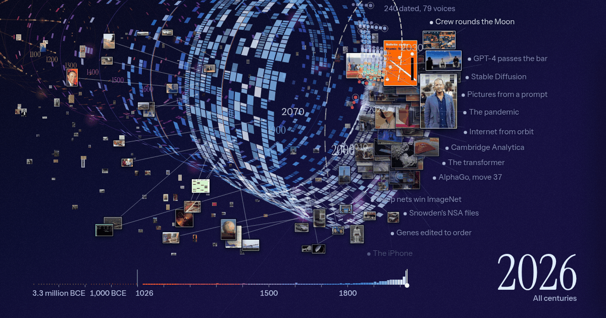

# Technology Histomap

A single-page, interactive spiral timeline of technology: 4,828 records from 3.3 million BCE to 2026, drawn as one turn per century since 1026, with eight roots reaching further back.



- **Live / source:** <https://technohistogram.pplx.app/>
- **Archive:** this repository; GitHub Pages is disabled
- **Mirrored:** 2026-11-22
- **Page build:** `126be355b3`
- **Data version:** `2a98e5e0fd`, 4,828 records

## What is here

This is a complete static mirror of the site's published front end, not a reimplementation. It includes the arrival sequence, the spiral intro, all 39 view modules, the full JSON data set and the 1,883 record images under `img/moments/`.

GitHub Pages has been retired. The repository stays as a source and asset archive; the live site is the original Perplexity deployment linked above.

```
index.html               entry point; import map, first-paint styles and prefetch
app.webmanifest          PWA manifest, scoped to ./
js/                      app modules, views, and js/vendor/d3.min.js
css/                     source stylesheets and generated view bundles
data/                    manifest + all JSON data (events, series, views, tours…)
arrival/                 globe point data and nine atlas sheets
img/moments/             1,883 full-size record images used by the evidence panels
assets/                  fonts, social image
vendor/                  three.js modules used by the arrival globe
tools/                   optional CSS/data maintenance scripts
```

## Run locally

ES modules and `fetch` do not work from `file://`. Serve the repository over HTTP:

```powershell
cd technohistogram
py -m http.server 8000
```

Open <http://localhost:8000/> for the intro, or <http://localhost:8000/#v=spiral> to go straight to the map.

Routing is hash-based: `#v=<view>`, optionally with `&v=`, `&e=`, `&tr=` and `&m=` parameters. With no hash, the page opens on the intro; a first visit also plays the 3D globe arrival from `js/arrival.js`.

## Editing notes

- The app is pure static front end: no backend, no package manager and no build step required to run it.
- The JavaScript is the uncompressed, commented working tree (`js/ui.js` and `js/data.js` included). View styles also exist as individual source sheets; the generated `css/shell.css` and `css/views-*.css` bundles are kept for the running site.
- If you edit a source stylesheet, regenerate the bundles with `py tools/bundle_css.py` (read `index.html`'s `css:bundle` list first).
- The host-injected Perplexity inline-edit bridge was removed from `index.html`; it was not part of the site.
- The 3D arrival uses the three.js files in `vendor/`; no external CDN is required.
- `img/moments/` is required for the record images in the evidence panel; every one of its 1,883 files is referenced by `data/events_text*.json`.

## Source and rights

The original site is [technohistogram.pplx.app](https://technohistogram.pplx.app/), captured on 2026-11-22. All code, data, writing and images remain with the original authors and publishers. The source does not include an open-source licence, so this repository is an attributed static mirror for demonstration and preservation, not an official distribution or a claim of ownership.
